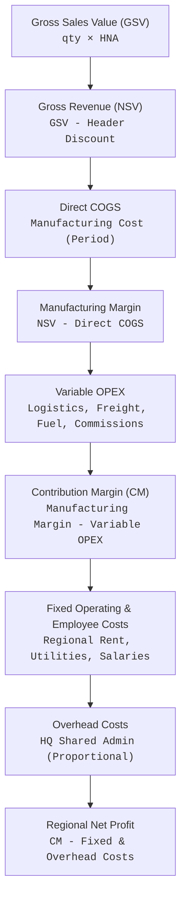

# Regional P&L & Contribution Margin System — User Manual

**Version:** 1.0  
**Application:** `ql` (Quantum Laboratories Frappe Custom App)  
**Target Audience:** Finance Directors, Regional Sales Managers, Commercial Controllers, System Administrators  

---

## 1. Executive Overview

The **Regional P&L & Contribution Margin System** is an enterprise financial analytics module built inside ERPNext/Frappe. It bridges commercial sales performance directly with cost accounting and General Ledger expenses to produce multi-tier hierarchical Profit and Loss (P&L) statements across corporate sales structures (GSM $\rightarrow$ SM $\rightarrow$ DM $\rightarrow$ MR).



### Core Financial Metrics
| Metric | Full Name | Computation Logic | Purpose |
| :--- | :--- | :--- | :--- |
| **GSV** | Gross Sales Value | $\sum (\text{Qty} \times \text{HNA / Unit Price})$ | Evaluates total sales volume before discounts |
| **NSV** | Net Sales Value | Proportional allocation of header `custom_nsv1` | Actual commercial net revenue received |
| **Direct COGS** | Cost of Goods Sold | $\sum (\text{Qty} \times \text{Unit Manufacturing Cost})$ | Direct production/material cost of goods sold |
| **Mfg Margin** | Manufacturing Margin | $\text{NSV} - \text{Direct COGS}$ | Factory-level gross profitability |
| **Var OPEX** | Variable Operating Expense | Direct logistics, delivery freight, sales commissions | Incremental expenses incurred per delivery/sale |
| **CM** | Contribution Margin | $\text{Mfg Margin} - \text{Var OPEX}$ | Surplus remaining to cover fixed & regional costs |
| **CM %** | Contribution Margin Ratio | $(\text{CM} / \text{NSV}) \times 100\%$ | Efficiency index of regional commercial operations |
| **Net Profit** | Regional Net Profit | $\text{CM} - (\text{Fixed Op} + \text{Salaries} + \text{HQ Overhead})$ | Bottom-line operational profit per territory |

---

## 2. Navigating the Module

### 2.1 Workspace Access
1. Log into your ERPNext instance.
2. In the left navigation sidebar or via AwesomeBar search (`Ctrl+K`), search for **Regional P&L & Contribution Margin**.
3. Direct URL: `/app/regional-p-l`.

### 2.2 Workspace Layout
The workspace is organized into three distinct operational sections:
- **Executive Financial Highlights**: Top-level Number Cards displaying high-level period totals.
- **Charts & Trajectory Visualizations**: Multi-dimensional charts comparing regional nodes, product profitability, cost breakdowns, and historical trends.
- **Quick Links**: Direct shortcuts to Financial Reports, Master Data, and Costing Doctypes.

---

## 3. Executive Dashboard & Visualizations

```
┌─────────────────────────────────────────────────────────────────────────────────────────────┐
│                              EXECUTIVE FINANCIAL HIGHLIGHTS                                 │
├──────────────┬──────────────┬────────────────────────┬──────────────────────┬───────────────┤
│  Total NSV   │ Direct COGS  │  Contribution Margin   │ Contribution Margin% │  Net Profit   │
│ Rp 3.42 Mily │ Rp 259 Juta  │      Rp 3.16 Mily      │        92.42%        │ Rp 3.16 Mily  │
└──────────────┴──────────────┴────────────────────────┴──────────────────────┴───────────────┘
```

### 3.1 Executive Number Cards
- **Total Net Sales (NSV)**: Dynamic real-time revenue after discounts for the active filter period.
- **Total Direct COGS**: Total variable production cost matched against the period's manufacturing costs.
- **Total Contribution Margin**: Gross commercial margin before deducting fixed overhead.
- **Contribution Margin %**: Percentage margin efficiency ($>85\%$ highlighted in Green, $<50\%$ highlighted in Orange).
- **Regional Net Profit**: Final bottom line after distributing local fixed expenses and corporate overhead.

### 3.2 Visual Charts
1. **Sales Performance by Geography (SM Node)**
   - *Chart Type*: Grouped Bar Chart
   - *Shows*: Net Revenue vs. Contribution Margin grouped by regional Sales Manager (SM).
   - *Use Case*: Quickly spot high-revenue regions that suffer from low contribution margins due to high discount or logistics rates.
2. **Product Revenue & Margin Breakdown**
   - *Chart Type*: Multi-series Bar Chart (Top 8 SKUs)
   - *Shows*: Net Revenue alongside Contribution Margin for the 8 largest selling items.
   - *Use Case*: Identifies which key product lines drive cash flow vs. which drive profitability.
3. **Regional P&L Cost Stack**
   - *Chart Type*: Stacked Waterfall / Cost Layer Bar
   - *Shows*: Stacked composition of Direct COGS, Variable OPEX, Fixed Operations, Employee Salaries, and Net Profit.
4. **Hierarchical Sales Trajectory**
   - *Chart Type*: Multi-period Line Chart
   - *Shows*: Month-over-month trajectory curves for top corporate branches and supervisory groups.

---

## 4. Master Data & Configuration

### 4.1 Sales Hierarchy Dynamic Extraction (`tabSales`)
The reporting and pivot tree hierarchy is derived directly and solely from `tabSales` transaction records, independent of the `Sales Person` DocType. Every sales order contains dedicated fields identifying the complete organizational sales chain:
- **`custom_gsm`**: General Sales Manager (Level 0 / Root)
- **`custom_sm`**: Sales Manager (Level 1)
- **`custom_dm`**: District Manager / Territory Sector (Level 2)
- **`custom_mr`**: Medical Representative / Territory Leaf (Level 3)

```
[GSM] GSM01 - BAYU PRAMONO (General Sales Manager)
  └── [SM] SM01 - AGUSTINAWATI (Sales Manager)
        └── [DM] JATENG1.3 - NOFRI HARTOTO (District Manager)
              ├── [MR] JATENG1.1.2 - VACANT (Medical Representative)
              ├── [MR] JATENG1.1.3 - MUHAMMAD MUTAMAKIN (Medical Representative)
              └── [MR] JATENG6.1.1 - DWI SETIANTO (Medical Representative)
```

#### Extraction via `extract_sales_team_data(raw_text)`:
The parser parses the multi-line sales string:
1. **Sales Person Name & ID**: Extracted before and after `#` (e.g. `ROBI SETIAWAN SAPUTRA #2120164`).
2. **Territory**: Cleaned by stripping parenthesized suffixes and removing `_QL2` and `_QUANTUM` (e.g. `LAMPUNG_QL2` $\rightarrow$ `LAMPUNG`, `SM01_QUANTUM` $\rightarrow$ `SM01`).
3. **Sales Tier**: Parsed from the middle component inside the trailing parentheses `(AREA_TIER_COMPANY)`:
   - `LPG_DM_QUANTUM` $\rightarrow$ `DM`
   - `PST_SM_QUANTUM` $\rightarrow$ `SM`
   - `MDN_REP_QUANTUM` $\rightarrow$ `MR` (`REP` mapped to `MR`)
   - `DPS_SPV_QUANTUM` $\rightarrow$ `SPV`
   - `PST_GSM_QUANTUM` $\rightarrow$ `GSM`

### 4.2 Period Costing Master (`Manufacturing Cost`)
Located at: `/app/manufacturing-cost`
- **Product ID / Item Code**: Matches the `custom_item` or `item_code` in sales line items.
- **Period Start & End Date**: Sets the validity window for the standard costing batch (e.g., `2026-10-01` to `2026-10-31`).
- **Variable COGS per piece**: Standard variable manufacturing rate (materials + direct power).
- **Statutory Valuation Rate**: Full absorbed inventory valuation rate under statutory GAAP.

### 4.3 Dedicated Cost Input DocTypes (Replacing `tabGL Entry`)
Instead of querying `tabGL Entry`, all variable and fixed operating, employee, and factory costs are derived directly from two dedicated monthly input DocTypes:

#### 1. `Manufacturing Overhead` (`tabManufacturing Overhead`)
- **Maintained by:** Manufacturing Department (`Manufacturing User` / `Manufacturing Manager`)
- **Naming:** `MOH-YYYY-MM` (Snaps `period_date` to `01-MM-YYYY`, 1 record per company/month)
- **Biaya Overhead Pabrik Variabel (Deducted for Contribution Margin):** Biaya Kerusakan Bahan Baku/Kemasan/Barang Jadi, Biaya Analisa, Jasa Pengujian, Biaya Pengolahan Limbah, Biaya Impor, Biaya Ekspedisi.
- **Biaya Overhead Pabrik Tetap / Fixed MOH (Deducted for Net Profit):** Biaya Pegawai Tak Langsung, Keamanan, Rumah Tangga, Pabrik Lainnya, Penyusutan Bangunan/Mesin/Inventaris, ATK, Cetakan, Listrik & Air, Asuransi, Perjalanan Dinas, Entertainment, Training, Pemeliharaan & Perbaikan, Jasa Pemeliharaan, R&D, Sewa Tabung/Peralatan/Kendaraan.
- **Allocation Method:** Allocated proportionally to each regional node based on revenue share:
  $$\text{Node Revenue Share} = \frac{\text{Node Gross Revenue (NSV)}}{\text{Total Company Gross Revenue}}$$

#### 2. `Sales Operational Cost` (`tabSales Operational Cost`)
- **Maintained by:** Commercial & Marketing Team (`Marketing User` / `Marketing Manager` / `Sales Master Manager`)
- **Naming:** `SOC-{territory}-{YYYY}-{MM}` (Snaps `period_date` to `01-MM-YYYY`, 1 record per period + territory + sales_person)
- **Biaya Operasional & Penjualan Variabel (Deducted for Contribution Margin):** Biaya Komisi Penjualan, Biaya Pendistribusian Produk, Biaya Ekspedisi.
- **Biaya Karyawan & Operasional Tetap (Deducted for Net Profit):** Biaya Gaji, Rumah Tangga, Perjalanan Dinas, Entertainment, ATK, Cetakan, Listrik & Air, Pemeliharaan Kendaraan, Jasa Pemeliharaan Kendaraan, Telepon & Internet, Penyusutan Kendaraan, Penyusutan Inventaris Kantor.
- **Rollup Method:** Direct assignment to matching territory / sales person node with hierarchical rollup to supervisory managers (MR $\rightarrow$ DM $\rightarrow$ SM $\rightarrow$ GSM).

---

## 5. Standard Reports Guide

### 5.1 Report: Regional Contribution Margin P&L
**Access:** Open `/app/query-report/Regional Contribution Margin P&L`

```
┌──────────────────────────────────────────────────────────────────────────────────────────────────────────────────┐
│ Filters: [Company: Quantum Laboratories] [From: 2026-10-01] [To: 2026-10-31] [Costing: Variable Costing]         │
├───────────────────────────────┬──────┬──────────────┬──────────────┬─────────────┬─────────────┬─────────────────┤
│ Sales Person / Territory      │ Tier │     GSV      │   Net NSV    │ Direct COGS │   Mfg CM    │   Net Profit    │
├───────────────────────────────┼──────┼──────────────┼──────────────┼─────────────┼─────────────┼─────────────────┤
│ ▼ GSM01 - BAYU PRAMONO        │ GSM  │ Rp 11.23 M   │ Rp 3.90 M    │ Rp 259.2 Jt │ Rp 3.64 M   │ Rp 3.64 M       │
│   ▼ SM01 - AGUSTINAWATI       │ SM   │ Rp  6.91 M   │ Rp 2.26 M    │ Rp 140.8 Jt │ Rp 2.12 M   │ Rp 2.12 M       │
│     ▼ JATENG1.3 - NOFRI H.    │ DM   │ Rp  1.32 M   │ Rp 457.4 Jt  │ Rp  27.2 Jt │ Rp 430.2 Jt │ Rp 430.2 Jt     │
│         JATENG1.1.3 - M. M.   │ MR   │ Rp 560.0 Jt  │ Rp 195.6 Jt  │ Rp   3.6 Jt │ Rp 191.9 Jt │ Rp 191.9 Jt     │
└───────────────────────────────┴──────┴──────────────┴──────────────┴─────────────┴─────────────┴─────────────────┘
```

#### Available Report Filters:
1. **Company**: Selects accounting entity (defaults to user default company).
2. **From Date / To Date**: Filter range for `custom_customers_purchase_order_date` (defaults to previous 30 days).
3. **Hierarchy Level**:
   - `All`: Full interactive nested tree view (`GSM` down to leaf `MR`).
   - `GSM`: General Sales Manager executive level.
   - `SM`: Sales Manager regional level.
   - `DM`: District Manager territory sector level.
   - `MR`: Medical Representative leaf level.
4. **Costing Basis**:
   - `Variable Costing (Contribution)`: Uses `variable_cogs_per_piece` from Manufacturing Cost.
   - `Statutory Valuation`: Uses `statutory_valuation_rate` from Manufacturing Cost.
5. **Document Status**:
   - `All (0 & 1)`: Includes drafts and submitted orders.
   - `Submitted Only (1)`: Audited submitted transactions only.
4. **Costing Basis**:
   - `Variable Costing (Contribution)`: Uses `variable_cogs_per_piece` from Manufacturing Cost.
   - `Statutory Valuation`: Uses `statutory_valuation_rate` from Manufacturing Cost.
5. **Document Status**:
   - `All (0 & 1)`: Includes drafts and submitted orders.
   - `Submitted Only (1)`: Audited submitted transactions only.

#### Interactive Visual Cues:
- **Bold Group Rows**: Parent nodes (GSM, SM, DM) are rendered in bold typeface.
- **Orange Highlight**: Negative Contribution Margin ($< 0$) is highlighted in bold amber.
- **Red / Green Highlight**: Net Profit is highlighted in green for positive return and red for operational deficit.

---

### 5.2 Report: Sales Person Pivot Tree Report
**Access:** Open `/app/query-report/Sales Person Pivot Tree Report`

#### Purpose:
Provides multi-dimensional matrix comparisons across calendar periods or item groups while retaining full tree rollups.

#### Key Features:
- **Pivot By**:
  - `Monthly (Jan-Dec)`: Generates individual dynamic currency columns for each month in the selected date range.
  - `Quarter`: Groups performance by Q1, Q2, Q3, Q4.
  - `Item Group / Product`: Analyzes sales by top 15 revenue-generating SKUs plus an *Other Products* bucket.
- **Value Field**:
  - `NSV`: Net revenue after discount.
  - `GSV`: Gross catalog value before discounts.
  - `Item Amount`: Raw line-item value.
  - `Contribution Margin`: Line-item revenue minus piece manufacturing cost.
- **Hierarchy Level**:
  - Filter matrix rows by specific tier (`All`, `GSM`, `SM`, `DM`, `MR`).
- **Accumulated Sales (Total)**:
  - Anchored on the far right of the grid with a distinct gray/slate border to guarantee readability across wide screen tables.

---

## 5.3 Frappe Insights & Executive Narrative Commentary

### 5.3.1 In-Report Automated Financial Insights Banner
Both the **Regional Contribution Margin P&L** and **Sales Person Pivot Tree Report** are equipped with automated analytical insight banners rendered directly above the report tables:

1. **Regional Contribution Margin P&L Insights**:
   - 🏆 **Top Regional Contributor**: Automatically flags the SM / territory driving highest Contribution Margin with absolute amount and CM %.
   - ⚠️ **Margin Attention Node**: Detects margin dilution, high discounting, or cost pressure in underperforming nodes.
   - 📊 **Cost Structure Ratios**: Live breakdown of Direct COGS %, Variable OPEX %, and Fixed Burden % relative to Total Net Sales (NSV).
   - 📝 **Dynamic Executive Commentary**: Evaluates overall margin health, value capture discipline, and bottom-line profit conversion.

2. **Sales Person Pivot Tree Insights**:
   - 🏆 **Leading Contributor**: Identifies the sales team member or branch generating maximum accumulated sales.
   - 📈 **Peak Sales Window**: Detects the highest-grossing month/quarter in the active filter range.
   - 📊 **Sales Trajectory Trend**: Automatically computes interval trajectory direction (Expanding, Contracting, or Stable).

### 5.3.2 Frappe Insights BI App (`/insights`)
The official **Frappe Insights** business intelligence app is installed and linked directly within the Regional P&L workspace:
- **Direct Workspace Access**: Click **Frappe Insights (BI)** from the workspace shortcuts or quick links to navigate to `/insights`.
- **Custom Workbooks & Exploratory BI**: Connect directly to MariaDB tables (`tabSales`, `tabSales Item`, `tabManufacturing Cost`, `tabGL Entry`) to create custom charts, interactive pivot tables, and scheduled PDF/email reports.


---

## 6. Architecture & Maintenance

### 6.1 Performance Architecture
To guarantee response times below **0.5 seconds** despite querying over 150,000 remote transaction rows:
1. **Header-First Querying**: Filters and retrieves parent records from `tabSales` matching date criteria.
2. **Batch Subquerying**: Batches child records from `tabSales Item` in slices of 1,000 using `WHERE parent IN (...)`.
3. **In-Memory Cost Lookup**: All period records from `tabManufacturing Cost` are loaded into memory once and hashed for $O(1)$ interval matching.
4. **Local Rollup**: Hierarchical summation executes in Python via Nested Set coordinate boundaries (`lft` and `rgt`).

### 6.2 Cache Maintenance
If workspace number cards or chart definitions are altered in development mode, run the following bench maintenance commands:
```bash
# Clear Python & Redis Desk Cache
bench --site qsdev.quantumlaboratoris.com clear-cache

# Re-migrate doctypes and fixtures if schemas change
bench --site qsdev.quantumlaboratoris.com migrate
```

---

## 7. Frequently Asked Questions (FAQ)

### Q1: Why do some territories show `0.00` Direct COGS?
**Answer:** This indicates that the item sold does not have an active record in `tabManufacturing Cost` for that purchase order date. Navigate to `/app/manufacturing-cost` and ensure all active product SKUs have valid period start/end dates.

### Q2: What happens if a sales order has multiple line items?
**Answer:** The header discount and Net Sales Value (`custom_nsv1`) are allocated across line items proportionally to each item's Gross Sales Value (`custom_quantity × custom_hna`).

### Q3: How do I export reports for external executive presentations?
**Answer:** From any report screen:
1. Click the **Actions** menu (three dots in top right corner).
2. Choose **Export**.
3. Select **Excel (XLSX)** or **CSV**. All indented hierarchy levels and formatted numbers are preserved.
